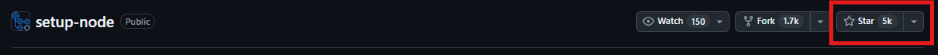
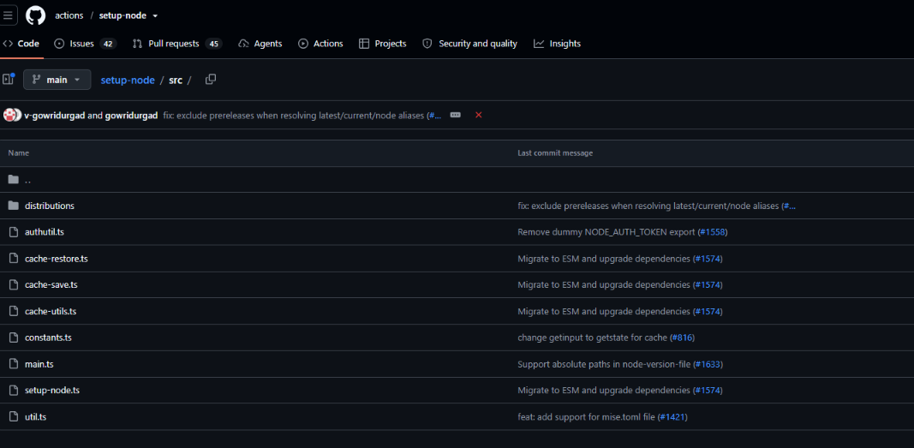

# FastAPI Starter

A minimal, production‑leaning FastAPI template with testing (coverage), linting/formatting, Docker, and CI. Ships with a root endpoint and a health check. 

# Premiere Modification

## Features
- FastAPI + Uvicorn
- Pydantic Settings for configuration management
- Custom logging with TRACE level support
- Testing with pytest + pytest-cov (HTML/XML coverage, 85% threshold)
- Ruff for linting and formatting; optional mypy typing
- Dockerfile and GitHub Actions CI (Python 3.13)

## Endpoints
- `GET /` → `{ "message": "the server is now active" }`
- `GET /health` → `{ "ok": true }`

## Quick Start
```bash
python -m venv .venv && source .venv/bin/activate  # Windows: .venv\Scripts\activate
pip install -r requirements-dev.txt
cp .env.example .env  # Optional: customize your environment variables
uvicorn app.main:app --reload --port 8000
```

Open [http://localhost:8000](http://localhost:8000) and [http://localhost:8000/health](http://localhost:8000/health)

## Testing with Coverage

```bash
pytest
# Outputs: htmlcov/ (HTML), coverage.xml (XML), threshold enforced via pyproject.toml
```

## Linting and Formatting

```bash
ruff check .
ruff format .
# Optional typing
mypy app
```

## Docker

```bash
docker build -t fastapi-starter .
docker run -p 8000:8000 fastapi-starter
```

## CI

GitHub Actions workflow runs linting and tests with coverage on Python 3.13. See `.github/workflows/ci.yml`.

## License

MIT. See [LICENSE](./LICENSE).


Testing GitHub Actions pull_request event.

---
# Reponses du tp 7 : 
•	Q1. Pourquoi actions/checkout n'a-t-il pas besoin de with alors que setup-node en a besoin ?
  - Q1. actions/checkout n'a pas besoin de with car ses paramètres par défaut suffisent pour récupérer le dépôt. En revanche, actions/setup-node utilise with pour préciser la version de Node.js à installer, ici 20.

•	Q2. Pourquoi le job verify ne retrouve-t-il pas report.txt sans l'artefact, alors que les deux jobs partagent le même dépôt ?
  - Chaque job s'exécute sur une machine différente. Le fichier report.txt créé dans le job build n'est donc pas automatiquement disponible dans verify. L'artefact permet de sauvegarder ce fichier et de le télécharger dans le deuxième job.

• Ouvrez le dépôt de actions/setup-node et relevez : le badge de créateur vérifié, le nombre d'étoiles et le dossier contenant le code source.






Q6. actions/checkout doit s'exécuter avant l'action locale pour récupérer le contenu du dépôt sur le runner. Sinon, GitHub ne peut pas trouver le fichier action.yml de notre action locale.

Q7. shell: bash est obligatoire pour les étapes run d'une action composite, car GitHub Actions exige de préciser explicitement le shell à utiliser pour exécuter chaque commande.